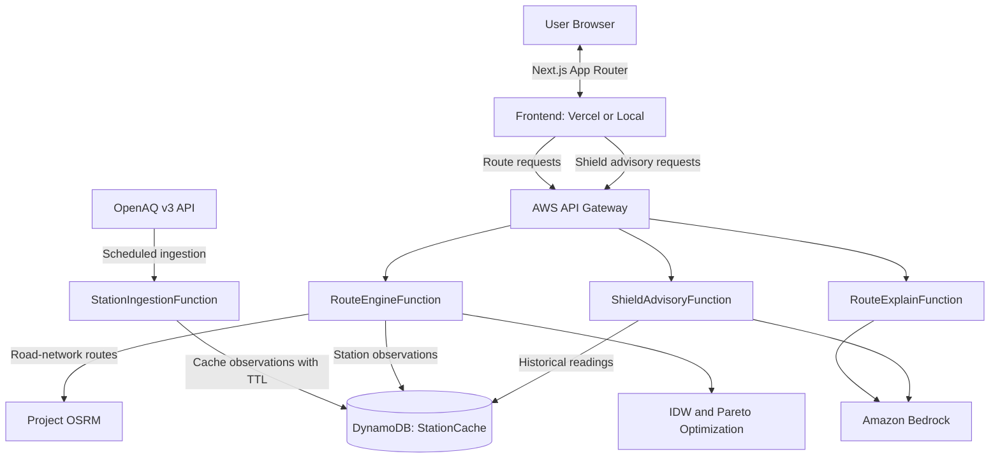

# AeroShift 🌬️🚗

> **Air-aware urban mobility and facility exposure intelligence platform.**
>
> AeroShift combines air-quality observations, road-network routing, modeled PM2.5 exposure estimates, multi-criteria route optimization, and facility-level advisories using AWS serverless services, OpenAQ, OSRM, and Amazon Bedrock.

---

## 🌟 Overview

Most navigation platforms prioritize travel time or distance. AeroShift explores an additional factor: **estimated particulate exposure during a journey**.

By combining available air-quality observations with spatial interpolation and a travel-mode-based inhalation model, AeroShift compares alternative routes based on both estimated travel duration and modeled exposure.

The platform also provides facility-level air-quality trends and operational advisories through AeroShift Shield.

AeroShift is a decision-support prototype. Its exposure values are model-based estimates, not direct measurements at every point, personal exposure measurements, medical advice, or guarantees of actual exposure.

## 🚀 Core Modules

### 1. AeroShift Move (`/`)

- **Three route strategies:** Fastest, Balanced, and Cleanest.
- **Spatial pollution estimation:** Uses Inverse Distance Weighting (IDW) to estimate PM2.5 concentrations between monitoring stations.
- **Mode-based exposure modeling:** Estimates inhaled particulate mass using route-segment duration and assumed ventilation multipliers for `car`, `two_wheeler`, and `active` travel modes.
- **Interactive visualization:** Displays route alternatives, pollution heatmaps, and trade-offs using MapLibre GL.
- **Navigation handoff:** Provides Google Maps links with route inputs and corridor waypoints, subject to URL and platform support.
- **AI-generated explanations:** Uses Amazon Bedrock to explain calculated route trade-offs.

### 2. AeroShift Shield (`/shield`)

- Provides facility-level PM2.5 trends and advisory information for schools, universities, and commercial campuses.
- Assigns operational risk categories: `Low`, `Medium`, `High`, and `Critical`.
- Generates action-oriented advisories related to ventilation and outdoor activities.
- Supports one-click export of advisory reports in `.txt` format.

Shield's risk categories and recommendations are decision-support outputs. They should not be interpreted as official public-health warnings or substitutes for guidance from relevant authorities.

---

## 🏗️ System Architecture

The following diagram illustrates the intended data and request flow. The actual trigger configuration should match the resources defined in `backend/template.yaml`.



### Request and Data Flow

1. A scheduled ingestion process retrieves available air-quality observations from OpenAQ.
2. The ingestion function stores station data in DynamoDB, where configured TTL settings allow cached records to expire.
3. The frontend sends route and facility-advisory requests through its API routes to API Gateway.
4. AWS Lambda functions handle route computation, route explanations, and facility advisories.
5. The route engine combines OSRM route geometry with available station observations, estimates concentrations along route segments, and compares candidate routes.
6. Amazon Bedrock generates explanatory text for route comparisons and facility advisories.

The deployed architecture depends on the actual SAM configuration, trigger resources, and environment settings.

---

## 🔬 Mathematical and Modeling Approach

### 1. Spatial PM2.5 Interpolation — Inverse Distance Weighting

AeroShift estimates the PM2.5 concentration at a coordinate along a road segment using nearby monitoring-station observations.

\[
\hat{C}(x)=
\frac{\sum_{i=1}^{N} C_i/d_i^p}
{\sum_{i=1}^{N}1/d_i^p}
\]

Where:

- \(\hat{C}(x)\) is the estimated concentration at the target coordinate.
- \(C_i\) is the observed concentration at monitoring station \(i\).
- \(d_i\) is the Haversine distance between the target coordinate and station \(i\).
- \(p\) is the distance-weighting power, set to \(2\) by default.

Closer stations receive greater weight than farther stations.

IDW is an interpolation technique, not a direct measurement at the target coordinate. Its accuracy depends on station coverage, observation freshness, and the spatial distribution of available data.

### 2. Modeled Inhaled PM2.5 Mass

AeroShift estimates inhaled particulate mass across route segments using estimated concentration, assumed ventilation rate, and segment duration.

\[
M =
\sum_{\text{steps}}
\left(
\hat{C}_{\text{step}}
\times
(\beta_{\text{mode}}\times V_{\text{base}})
\times
\frac{\Delta t_{\text{step}}}{60}
\right)
\]

Where:

- \(M\) is the modeled inhaled particulate mass in micrograms (\(\mu g\)).
- \(\hat{C}_{\text{step}}\) is the estimated PM2.5 concentration for a route segment.
- \(V_{\text{base}}\) is the baseline ventilation rate of \(8\ \text{L/min}\).
- \(\beta_{\text{mode}}\) is the assumed multiplier for the selected travel mode.
- \(\Delta t_{\text{step}}\) is the segment duration in minutes.

The configured travel-mode multipliers are:

| Travel mode | Multiplier | Modeling assumption |
|---|---:|---|
| Car (`car`) | 0.70 | Lower assumed exposure factor for an enclosed cabin |
| Two-wheeler (`two_wheeler`) | 1.30 | Greater assumed contact with ambient air |
| Active (`active`) | 2.20 | Elevated assumed ventilation during exertion |

These multipliers are modeling assumptions, not individualized physiological measurements. Actual exposure may vary with cabin filtration, traffic, weather, activity intensity, and individual characteristics.

### 3. Multi-Criteria Pareto Optimization

A route \(A\) dominates route \(B\) when it is no worse in both travel duration and modeled inhaled particulate mass, and strictly better in at least one.

\[
T_A \leq T_B
\quad \text{and} \quad
M_A \leq M_B
\]

with

\[
T_A < T_B
\quad \text{or} \quad
M_A < M_B
\]

Where:

- \(T\) represents estimated travel duration.
- \(M\) represents modeled inhaled particulate mass.

AeroShift uses Pareto comparison to identify non-dominated route alternatives.

- **Fastest:** Prioritizes minimum estimated travel duration.
- **Cleanest:** Prioritizes minimum modeled inhaled particulate mass.
- **Balanced:** Selects a compromise based on marginal exposure reduction relative to additional travel time along the Pareto frontier.

The resulting alternatives depend on candidate routes, available observations, and model assumptions. They represent comparisons between modeled alternatives, not guarantees of real-world exposure.

---

## 🛠️ Technology Stack

### Frontend

- **Framework:** Next.js 16 App Router
- **UI:** React 19, TypeScript, Tailwind CSS, Lucide Icons
- **Mapping:** MapLibre GL
- **Build tooling:** Turbopack

### Backend and Cloud

- **Runtime:** Python 3.11 / 3.12
- **Infrastructure as Code:** AWS Serverless Application Model (SAM)
- **Compute:** AWS Lambda
- **API Layer:** Amazon API Gateway
- **Database and Cache:** Amazon DynamoDB (`StationCache`, with TTL)
- **AI:** Amazon Bedrock (`amazon.nova-lite-v1:0` and `amazon.titan-text-lite-v1`, as configured)
- **Air-Quality Data:** OpenAQ API v3
- **Road Routing:** Project OSRM using `https://router.project-osrm.org` by default

The public OSRM endpoint is intended for development and demonstration. Review its usage policies and consider a suitably provisioned routing service before using this architecture for production workloads.

---

## 📁 Repository Structure

```text
AeroShift/
├── backend/
│   ├── src/
│   │   ├── bedrock_summary.py      # Bedrock explanations and fallback guidance
│   │   ├── exposure_model.py       # Modeled particulate inhalation
│   │   ├── idw.py                  # Inverse Distance Weighting
│   │   ├── ingest_stations.py      # OpenAQ station ingestion
│   │   ├── pareto.py               # Pareto filtering and route selection
│   │   ├── route_engine.py         # Route computation and corridor generation
│   │   ├── route_explain.py        # Route comparison explanation handler
│   │   ├── routing_client.py       # OSRM HTTP client
│   │   ├── shield_handler.py       # Facility advisory handler
│   │   ├── station_repository.py   # DynamoDB station repository
│   │   └── tests/                  # Backend pytest test suite
│   ├── env.json                    # Local SAM environment configuration
│   └── template.yaml               # AWS SAM / CloudFormation template
├── frontend/
│   ├── app/
│   │   ├── api/
│   │   │   ├── routes/             # Route proxy and mock fallback
│   │   │   ├── routes/explain/     # Route explanation proxy
│   │   │   └── shield/advisory/    # Advisory proxy and sanitization
│   │   ├── shield/                 # AeroShift Shield page
│   │   ├── layout.tsx              # Root layout and metadata
│   │   └── page.tsx                # AeroShift Move route planner
│   ├── components/                 # Map, route cards, selectors, and header
│   ├── lib/                        # Types, API client, and polyline decoder
│   └── public/                     # Static assets
└── README.md
```

---

## 🚀 Getting Started

### Prerequisites

- Node.js version supported by the project's `package.json` and Next.js version
- Python 3.11 or 3.12
- AWS SAM CLI for the documented backend deployment workflow
- OpenAQ API key, if required by the station-ingestion configuration

### 1. Frontend Setup

From the repository root:

```bash
cd frontend
npm install
```

Create `frontend/.env.local`:

```env
# Leave blank to use the built-in offline demo mode,
# or set your deployed API Gateway endpoint.
AEROSHIFT_API_URL=
```

If you want to use a deployed backend, set `AEROSHIFT_API_URL` to the intended API Gateway endpoint.

**Security note:** Do not place AWS access keys, secret keys, or other credentials in frontend environment variables. Only expose an endpoint that you intend to make publicly accessible, and configure suitable access controls and usage limits.

Start the development server:

```bash
npm run dev
```

Open [http://localhost:3000](http://localhost:3000) in your browser.

To type-check and build:

```bash
npx tsc --noEmit
npm run build
```

### 2. Backend Setup and Testing

From the repository root:

```bash
cd backend
python -m venv .venv
```

Activate the virtual environment.

**Windows:**

```powershell
.venv\Scripts\activate
```

**macOS/Linux:**

```bash
source .venv/bin/activate
```

Install the backend testing dependencies:

```bash
pip install pytest requests boto3
```

Run the test suite from the repository root:

```bash
python -m pytest -o pythonpath=backend/src backend/src/tests -v
```

Install any additional dependencies required by the backend deployment configuration before deploying or running the backend.

### 3. Deploying to AWS with SAM

From the backend directory:

```bash
sam build
sam deploy --guided
```

Provide required parameters such as `OpenAQApiKey` and `BedrockModelId` when prompted, if those parameters are defined in `backend/template.yaml`.

Before deployment, verify IAM permissions, API exposure, model access, service quotas, and expected costs in your AWS account.

---

## 🧪 Testing

The backend test suite covers the following areas:

- **`test_exposure.py`:** Inhaled-mass calculations, mode multipliers, and duration behavior.
- **`test_idw.py`:** Haversine distance, inverse-distance weighting, and handling of missing or stale station data.
- **`test_pareto.py`:** Non-dominated route filtering, balanced selection, duration preservation, and travel-mode consistency.
- **`test_shield.py`:** Trend evaluation and fallback behavior when data is missing.

The project documentation lists 18 backend tests. Run the test command above to verify the current test count and results before citing that number in a submission.

---

## ⚠️ Important Limitations

### Travel-Time Estimates

AeroShift uses OSRM road-network routing. The configured routing setup does not provide live-traffic predictions based on floating-car probe data.

Consequently:

- Actual travel times can differ significantly due to traffic, road closures, and local conditions.
- Route times should be interpreted as network-based estimates rather than live-traffic ETAs.
- Google Maps handoff is available for live navigation and traffic-aware rerouting.

### Air-Quality and Exposure Estimates

- Observations are available only where monitoring coverage and data availability permit.
- IDW estimates concentrations between stations; it does not directly measure pollution at every route coordinate.
- Modeled inhaled mass depends on estimated segment durations and assumed ventilation multipliers.
- Results are not personal exposure measurements, medical advice, or guarantees that one route is safer than another.

AeroShift aims to make environmental trade-offs more visible while communicating the uncertainty and limitations of the available data.

---

## 📄 License

Licensed under the [MIT License](LICENSE).
