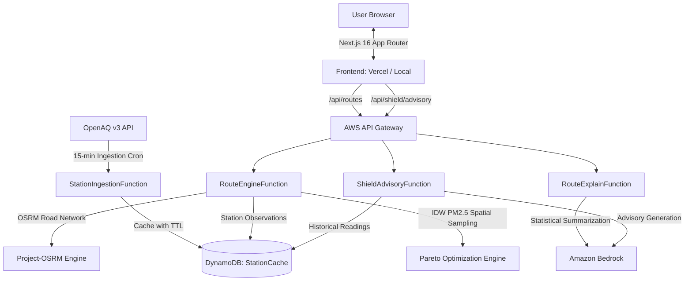

# AeroShift 🌬️🚗

> **Air-aware urban mobility and facility exposure intelligence platform.**  
> Modeled ambient PM2.5 particulate exposure evaluation, multi-criteria Pareto route optimization, and operational facility advisories powered by AWS Serverless, OpenAQ, OSRM, and Amazon Bedrock.

---

## 🌟 Overview

Standard navigation platforms optimize solely for travel time or distance, ignoring respiratory exposure. **AeroShift** introduces an exposure-aware routing and facility advisory system that combines real-time ambient air quality observations with spatial interpolation and physiological inhalation modeling.

### Core Modules:
1. **AeroShift Move (`/`)**:
   - Compares 3 distinct route strategies: **Fastest**, **Balanced**, and **Cleanest**.
   - Integrates spatial air pollution interpolation (Inverse Distance Weighting - IDW) with physiological vehicle-mode ventilation rates (`car`, `two_wheeler`, `active`).
   - Visualizes routes, pollution heatmaps, and tradeoffs interactively via MapLibre GL.
   - Provides seamless navigation handoff to Google Maps preserving origin, destination, vehicle mode, and corridor waypoints.
   - Explains route trade-offs using factual Bedrock LLM summaries.

2. **AeroShift Shield (`/shield`)**:
   - Facility-level air quality advisory dashboard designed for schools, universities, and commercial campuses.
   - Evaluates PM2.5 trends and computes operational risk levels (`Low`, `Medium`, `High`, `Critical`).
   - Generates actionable operational bulletins (ventilation management, outdoor activity restrictions).
   - Allows one-click export of structured advisory reports (`.txt`).

---

## 📐 System Architecture



---

## 🔬 Mathematical & Scientific Formulation

### 1. Spatial PM2.5 Interpolation (Inverse Distance Weighting - IDW)
For any coordinate along a road step $(x_k, y_k)$, ambient concentration $\hat{C}$ is estimated from surrounding monitoring stations $S$:

$$\hat{C} = \frac{\sum_{i=1}^N \frac{C_i}{d_i^p}}{\sum_{i=1}^N \frac{1}{d_i^p}}$$

- $d_i$: Haversine distance from coordinate $(x_k, y_k)$ to monitoring station $i$.
- $p$: Inverse distance weighting power factor (default $p = 2$).

### 2. Physiological Inhalation Model
Inhaled PM2.5 particulate mass $M$ ($\mu\text{g}$) is calculated from modeled concentration, vehicle-specific physiological ventilation factor, and step travel duration:

$$M = \sum_{\text{steps}} \left( \hat{C}_{\text{step}} \times (\beta_{\text{mode}} \times V_{\text{base}}) \times \frac{\Delta t_{\text{step}}}{60} \right)$$

- $V_{\text{base}}$: Baseline minute ventilation volume ($0.48\,\text{m}^3/\text{h}$ or $8\,\text{L/min}$).
- $\beta_{\text{mode}}$: Physiological vehicle mode multiplier:
  - **Car (`car`)**: $\beta = 0.70$ (Cabin enclosure filtration)
  - **Two-Wheeler (`two_wheeler`)**: $\beta = 1.30$ (Direct ambient exposure)
  - **Active / Cycling (`active`)**: $\beta = 2.20$ (Elevated exertion ventilation)

### 3. Multi-Criteria Pareto Optimization
A candidate route $A$ dominates route $B$ if and only if:
$$T_A \le T_B \quad \text{and} \quad M_A \le M_B \quad \text{and} \quad (T_A < T_B \text{ or } M_A < M_B)$$
- **Fastest**: Strictly minimizes travel duration $T$.
- **Cleanest**: Strictly minimizes inhaled particulate mass $M$.
- **Balanced**: Maximizes marginal exposure reduction per minute of additional travel time along the Pareto frontier.

---

## 🛠️ Tech Stack

### Frontend
- **Framework**: [Next.js 16 (App Router)](https://nextjs.org/) with React 19 & TypeScript
- **Styling**: Tailwind CSS & Lucide Icons
- **Mapping**: [MapLibre GL](https://maplibre.org/)
- **Build Engine**: Turbopack

### Backend & Cloud
- **Runtime**: Python 3.11 / 3.12
- **Infrastructure as Code**: [AWS Serverless Application Model (SAM)](https://aws.amazon.com/serverless/sam/)
- **Compute**: AWS Lambda Functions
- **Database**: Amazon DynamoDB (`StationCache` table with TTL)
- **AI / LLM**: Amazon Bedrock (`amazon.nova-lite-v1:0` / `amazon.titan-text-lite-v1`)
- **Air Quality Data**: OpenAQ API v3
- **Routing Engine**: Project-OSRM (`https://router.project-osrm.org`)

---

## 📁 Repository Structure

```
AeroShift/
├── backend/
│   ├── src/
│   │   ├── bedrock_summary.py     # Bedrock LLM explanation & fallback guidance
│   │   ├── exposure_model.py      # Physiological particulate inhalation model
│   │   ├── idw.py                 # Inverse Distance Weighting interpolation
│   │   ├── ingest_stations.py     # OpenAQ v3 Delhi-NCR station ingestion
│   │   ├── pareto.py              # Pareto dominance & multi-criteria selection
│   │   ├── route_engine.py        # Core route computation & corridor generation
│   │   ├── route_explain.py       # Route comparison explanation handler
│   │   ├── routing_client.py      # OSRM HTTP client
│   │   ├── shield_handler.py      # Facility advisory evaluation handler
│   │   ├── station_repository.py  # DynamoDB station repository
│   │   └── tests/                 # Comprehensive pytest test suite (18 tests)
│   ├── env.json                   # Local SAM environment configuration
│   └── template.yaml              # AWS SAM CloudFormation template
│
├── frontend/
│   ├── app/
│   │   ├── api/
│   │   │   ├── routes/            # Route proxy & mock fallback
│   │   │   ├── routes/explain/    # Route explanation proxy
│   │   │   └── shield/advisory/   # Facility advisory proxy & sanitization
│   │   ├── shield/                # AeroShift Shield page (/shield)
│   │   ├── layout.tsx             # Root layout & metadata
│   │   └── page.tsx               # AeroShift Move route planner (/)
│   ├── components/                # MapView, RouteCards, RouteSelector, Header
│   ├── lib/                       # Types, API client, polyline decoder
│   └── public/                    # Static assets
└── README.md                      # Project documentation
```

---

## 🚀 Getting Started

### Prerequisites
- **Node.js**: v18.18+ or v20+
- **Python**: 3.11 or 3.12
- **AWS SAM CLI** (optional, for deploying backend)
- **OpenAQ API Key** (optional, for live station ingestion)

---

### 1. Frontend Setup

1. Navigate to the frontend directory:
   ```bash
   cd frontend
   ```

2. Install dependencies:
   ```bash
   npm install
   ```

3. Configure environment variables in `frontend/.env.local`:
   ```env
   # Leave blank to use built-in offline demo mode, or point to AWS API Gateway:
   AEROSHIFT_API_URL= <url>
   ```

4. Start the Next.js development server:
   ```bash
   npm run dev
   ```
   Open [http://localhost:3000](http://localhost:3000) in your browser.

5. Type check and build for production:
   ```bash
   npx tsc --noEmit
   npm run build
   ```

---

### 2. Backend Setup & Testing

1. Navigate to the backend directory:
   ```bash
   cd backend
   ```

2. (Optional) Create and activate a virtual environment:
   ```bash
   python -m venv .venv
   # Windows:
   .venv\Scripts\activate
   # Linux/macOS:
   source .venv/bin/activate
   ```

3. Install testing dependencies:
   ```bash
   pip install pytest requests boto3
   ```

4. Run all unit tests:
   ```bash
   python -m pytest -o pythonpath=backend/src backend/src/tests -v
   ```

---

### 3. Deploying to AWS (Serverless SAM)

1. Build the SAM application:
   ```bash
   sam build
   ```

2. Deploy to AWS:
   ```bash
   sam deploy --guided
   ```
   Provide your `OpenAQApiKey` and preferred `BedrockModelId` when prompted.

---

## 🧪 Testing Coverage

The backend test suite (`backend/src/tests/`) validates mathematical and logical correctness:
- **`test_exposure.py`**: Inhaled mass calculation, mode multipliers, duration invariance.
- **`test_idw.py`**: Haversine distance, inverse distance weighting, missing/stale station handling.
- **`test_pareto.py`**: Pareto non-domination filtering, balanced selection, duration preservation, vehicle mode consistency.
- **`test_shield.py`**: Custom trend data evaluation, fallback generation on missing data.

---

## ⚠️ Notes on Travel Time Estimates (ETA)

AeroShift uses **static topological graph routing** (OSRM) based on legal speed limits and network connectivity. It does **not** simulate live-traffic floating-car probe data (such as Google Maps live traffic). 

Consequently:
- Travel times represent **ideal free-flow network estimates**.
- Exposure comparisons highlight relative particulate dose differences across candidate corridors.
- Deep links to Google Maps are provided for real-time live navigation with traffic rerouting.

---

## 📄 License

Licensed under the [MIT License](LICENSE).
